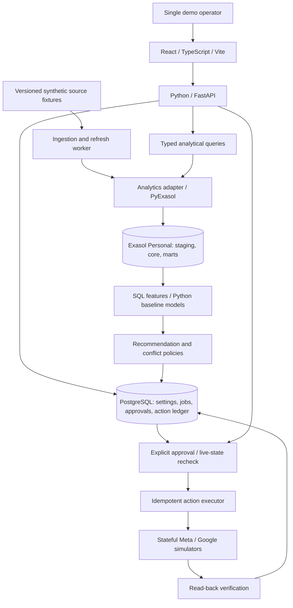

# AdVergent architecture

October 31 Phase 14 authorization: demo hardening is in progress; gate pending. `demo.py` reuses source-only scenario preparation for two disjoint run namespaces and compares semantic stockout advice/fixed budget facts, restoring defaults in `finally`. Read-only full-table hashes fence retained actions/state/control; inherited observation row hashes fence history. The A26 helper induces a real foundation SQL duplicate-key rollback; authenticated browser checks verify the exact previous complete publication and visible failure. The recovery runner stops/starts existing PostgreSQL/Exasol, proves outages, checks identical persistent mounts, restores all seven defaults and runs inherited analytical/private/TLS/history audits. No schema, API authority, source importer, worker command, dependency or analytics fallback is added. [Runbook](phase-14-demo.md), [handoff](handoffs/phase-14.md). Earlier Phase 14-unstarted statements are historical.

October 31 correction: **Phase 13 is complete at its synthetic local gate; Phase 14 remains unstarted**. `decisions.py` composes existing verified Exasol adapters through vendor-neutral conflict policy. Six coherent pins, cutoff/clock boundaries, a repeatable operational state snapshot including control timestamps, and full action-ledger comparison bracket the query. API/React expose typed decisions, explanations, invalidation and history on demand. Migration 009 stores immutable operational recommendation snapshots and once-only explicit action linkage; it adds no analytical source/publication or advertising write interface. Observation recording uses existing import/execution locks and an atomic PostgreSQL proof-time predicate. Historical outcomes come only from explicitly linked existing action steps. No analytics fallback or scenario-derived financial outcome exists. [Contract](phase-13-decisions.md), [handoff](handoffs/phase-13.md).

Last updated: 2026-10-31 (IST). Status: Phases 1–13 verified at their documented synthetic local gates with real PostgreSQL/Exasol. Phase 13 evidence is recorded in its handoff. Phase 14 remains proposed and requires another requested chat. Production scale, concurrency, stability and recovery guarantees remain unverified.

## Components and data flow

Arrows describe logical dependencies, not independent microservices. Phase 1 establishes one repository with separate API/worker entry points; Phases 6–8 add policy, approval and simulator components; Phase 10 adds read-only breakout evidence; later modules remain unimplemented.

## Phase 1 implementation

- `backend/advergent/api.py`: same-origin FastAPI JSON endpoints and built React assets. `openapi.json` generates frontend TypeScript contracts. Authentication stores only hashes of one-hour random session tokens in PostgreSQL. HttpOnly/SameSite Strict cookies and exact-Origin plus custom-header checks protect POST endpoints. Local HTTP uses loopback; HTTPS deployments require Secure cookies. No production throttling/multi-user administration is claimed.
- `backend/advergent/operational.py` and `migrations/001_foundation.sql`: PostgreSQL sessions, refresh jobs, migration version and singleton publication pointer. Migrations run explicitly. PostgreSQL errors produce sanitized 503 responses.
- `backend/advergent/exasol.py`: encrypted PyExasol connections, certificate validation or verified fingerprint, schema creation, transactional fixture loading and aggregation SQL. No vendor-specific SQL exists in API/business services. No alternate analytics adapter or computed-result fallback is implemented.
- `backend/advergent/worker.py`: immutable UUID derived from fixture SHA-256; serialized refresh under a PostgreSQL advisory lock; Exasol load/commit and golden query verification precede transactional PostgreSQL publication. Replay reuses the analytical dataset; jobs remain individually audited. Failed refresh preserves prior publication. The next lock holder marks crashed running jobs failed. There is no cross-database transaction or automatic orphan-dataset cleanup.
- `frontend/src/main.tsx`: operator login, actual query result/evidence, unavailable and not-loaded states, failed-refresh warning and logout. A new query clears prior numbers; expired sessions return to login. No ad actions are available.

Local whole-application operation is explicitly accepted on October 27. Exasol is managed by the pinned 2.3.0 Personal launcher and Podman; PostgreSQL 17.9 Alpine uses a persistent local container. Both database listeners are verified on loopback. The adapter pins the certificate copied from the trusted local container; the launcher's suggested `nocertcheck` is not used. Real golden/replay, PostgreSQL publication/session, transactional rollback, healthy/outage browser checks and database restart have passed. See [setup](phase-1-setup.md) and [handoff](handoffs/phase-1.md).

## Phase 2 implementation

- `commerce.py`: strict source models, fixture completeness/relationship validation, per-page delivery receipts, source-revision/tombstone handling and full snapshot reconciliation. A separate PostgreSQL advisory lock serializes commerce imports. Import resumes from the same fixture hash's durable page cursor; different bytes create a new version.
- `migrations/002_commerce.sql`: operational runs, attempt audits, temporary JSON source staging, delivery deduplication and separate commerce publication pointer. Successful replay audits the attempt while preserving the immutable dataset completion time. Staging is for import recovery, not analytical serving.
- `commerce_sql.py`, mixed into `ExasolAnalytics`: seven typed core tables with retained source payloads and one completion marker. Transactional batched inserts precede full source/core read-back and PostgreSQL publication. Counts, inventory/line/refund totals and delivered-line joins execute in Exasol. Exasol schema/SQL stay inside the adapter.
- `commerce_fixture.py` and `fixtures/commerce-v1.json`: deterministic 180-day synthetic input, 30 products/180 variants/1,000 customers/3,000 orders; explicit duplicate, late, missed and deleted source scenarios. No precomputed financial dashboard output.
- `GET /api/commerce` and dataset-pinned `GET /api/commerce/records/{kind}`: authenticated typed snapshot/record responses, real query evidence and source-age freshness; unavailable analytics returns no current totals. `frontend/src/Commerce.tsx` renders freshness and paginated escaped source fields alongside the separate foundation metric.

See [commerce contract](phase-2-commerce.md) for reconciliation semantics and [Phase 2 handoff](handoffs/phase-2.md) for real-store/browser evidence. Publication remains an explicit two-store boundary, with no cross-database transaction, cleanup, live-source completeness or high-availability claim.

## Phase 3 implementation

- `ads.py`: strict reporting/hierarchy contracts, exact rupee/micros-to-paise normalization, explicit source/India timezone dates and ownership/capability derivation. Stateful read-only Meta/Google source simulations persist independent page cursors and latest report revisions in PostgreSQL. One advertising advisory lock serializes imports. Native product hints do not resolve commerce mappings.
- `ads_fixture.py`, `fixtures/ads-initial-v1.json` and `fixtures/ads-corrected-v1.json`: independently importable complete bounded report histories; Meta ad-set/campaign owners, Google shared Search budget, Shopping-like and nonshared PMax-like multi-product resources; duplicate, late, delayed and zero-correction cases.
- `migrations/003_ad_reporting.sql`: ad runs/attempts, per-platform cursors, source revision staging and separate ad publication. Hash plus normalization schema namespace identifies immutable datasets. Retry skips committed pages; successful replay preserves original source/completion time.
- `ads_sql.py`, mixed into `ExasolAnalytics`: transactional entities, typed hierarchy and spend facts, completion marker, full read-back, actual Exasol campaign/day/budget joins and aggregation. Both SQL failure and verification failure preserve prior PostgreSQL publication. Commit-before-publication failure recovers by verifying/reusing the immutable dataset. No vendor SQL is embedded in source adapters, API or UI.
- `GET /api/ads`, typed `AdSnapshot` and `frontend/src/Ads.tsx`: authenticated real Exasol results and visible capabilities/unsupported controls; source observation, source-age freshness, SHA-256/version and query evidence. Unavailable analytics suppresses all current facts/capabilities while retaining publication evidence. No operational analytics fallback or mutation endpoint exists.

Detailed ownership, precision/grain defaults and replacement semantics: [ad reporting](phase-3-ad-reporting.md). Real-store and healthy/actual-outage browser evidence: [Phase 3 handoff](handoffs/phase-3.md). Source/capability simulation does not establish live API fidelity. Mapping/attribution is added in Phase 4 below; finance and action execution remain later components.

## Phase 4 implementation

- `attribution.py` and `attribution_fixture.py`: strict reviewed relationship/evidence contracts, validity/override resolution, ambiguity abstention and versioned seven-day first-party assignment. Explicit event identity deduplicates; latest-time campaign ties abstain. Native source hints never resolve commerce relationships. Configuration changes use new complete immutable source files through the trusted worker.
- `migrations/004_attribution.sql`: PostgreSQL configuration/override snapshots, pinned commerce/ad IDs, immutable runs, audited attempts and separate publication. Existing upstream advisory locks plus an attribution lock pin inputs through publication; successful replays preserve source/completion timestamps.
- `attribution_sql.py`, mixed into `ExasolAnalytics`: transactionally loads full evidence, typed unique order assignments and completion marker. Real analytical joins allocate purchased lines/products, link refunds and reconcile counts/exact paise to pinned commerce. Full read-back precedes PostgreSQL publication. SQL or post-commit verification failures retain prior publication; retry reuses verified immutable data.
- Authenticated `GET /api/attribution`, typed `AttributionSnapshot` and `frontend/src/Attribution.tsx`: relationships/provenance, allocation/product breakdown, order reasons, separate synthetic platform claims, source age/model/input/hash/query evidence and dependency-change warning. Analytics unavailability removes all current data. There is no operational analytics fallback, live tracking, mapping editor, advertising mutation or full finance.

Detailed resolution, temporal and allocation contracts: [Phase 4 contract](phase-4-mapping-attribution.md). Executed local gate: [Phase 4 handoff](handoffs/phase-4.md). Earlier handoffs remain historical; mappings and assignments were added only in Phase 4.

## Phase 5 implementation

- `finance.py` and `finance_fixture.py`: strict complete financial ledger/configuration, preserved historical cost provenance, explicit effective line corrections, deterministic exact-paise order allocation, delivery/cash/refund/recovery events and remaining-unit reserve inputs. Source evidence is synthetic; no platform calls or advertising writes occur.
- `migrations/005_finance.sql`: PostgreSQL immutable configuration snapshots, pinned commerce/ad/attribution IDs, attempts and independent finance publication. Shared upstream advisory locks pin dependencies through publication; current attribution inputs must match before importing.
- `finance_sql.py`, mixed into `ExasolAnalytics`: transactional typed financial lines/events/marker, full source/core verification, actual SQL net sales/product cost/contribution, unique first-party campaign joins, connected spend, coverage, transaction/acquisition date views and exact reconciliation. Null costs propagate. SQL and post-commit verification failure retain the prior pointer; replay verifies retained datasets.
- Authenticated `GET /api/finance`, generated `FinanceSnapshot` contracts and `frontend/src/Finance.tsx`: separate placed/delivered/cash amounts, realized/expected contribution, qualified snapshot ratios, missing/estimated cost coverage, reserve assumptions/maturity, allocations and line provenance. Pinned input cutoffs/dependency changes remain visible. Analytics failure removes all current financial data; operational configuration never becomes an analytical fallback.

Detailed defaults, precision, source limits and verification: [finance contract](phase-5-finance.md) and [Phase 5 handoff](handoffs/phase-5.md). That historical Phase 5 delivery introduced no inventory/recommendation/action modules; Phase 6 is separately described below.

## Data ownership

- Exasol: analytical joins, aggregations, order/line economics, inventory history, attribution relationships, cohorts, model features, and results.
- PostgreSQL: user/merchant context, configuration, job state, approvals, action history/locks, simulated external state, and operational ingestion checkpoints/receipts/source staging. Commerce/ad analytical tables and query results belong to Exasol.
- Fixtures: reproducible source input, scenario seed/clock, expected golden results, and controlled failure instructions. Dashboard results must be calculated through Exasol.
- Dataset version and demo run ID tie stores together. Publish completed analytical versions; do not pretend cross-database atomic transactions exist.

## Interfaces

- UI to API: typed request/response contracts, including evidence timestamps, incomplete metrics, recommendation state, and simulated/live labels.
- Business services to analytics: named typed operations for contribution, inventory risk, cohorts, and features. Vendor SQL and connection/loading behavior remain behind the adapter.
- Ingestion to analytics: typed source records with stable IDs, event/source timestamps, cost provenance, run ID, and deduplication keys.
- Executor to platform adapter: inspect capabilities, read current state, validate proposed mutation, apply approved mutation, and read back. Simulators implement these contracts for the demo; live fidelity remains unverified.
- Recommendations to executor: exact resources and changes, expected prior state, evidence/model versions, expiry, and approval identity. A recommendation alone authorizes no mutation.

## Replacement and recovery

Replacing Exasol requires a new analytics adapter, schema/data migration, common semantic fixtures, and performance verification. Business rules and API/UI contracts should remain independent. No second vendor adapter is part of the demo.

Resource locks, idempotency records, read-back after timeout, and explicit partial/unknown states govern actions. Inventory restrictions override growth recommendations. See the [metric/action contract](phase-0/metric-contract.md).

## Cloud deployment remains conditional

Cloud application preferred; AWS Free plan remains conditional. The user reconfirmed Free-plan status in Phase 1; current credit balance, account quotas, eligible compute/storage and full resource cost remain unverified. No AWS CLI/profile was available at preflight. No cloud resources were provisioned. The pinned Exasol AWS preset's `r6i.xlarge` default is not cleared. Never expose the database publicly as a hybrid workaround. Phase 1 uses the accepted local whole-app fallback. See [deployment-decision.md](phase-0/deployment-decision.md) for prior evidence and stop conditions.

React/Vite, FastAPI, PostgreSQL and Exasol are implemented and verified for this local foundation slice. Model libraries remain later scope. See [Phase 0 defaults](phase-0/README.md).

## Phase 6 implementation

- `inventory.py` and `inventory_fixture.py`: strict complete warehouse observations, demand/exposure counters, nullable lead settings, replenishment evidence and simulated resource/pause provenance. Vendor-neutral decimal policy evaluates stockout, throttle, weighted sizes, uncertainty, freshness, exact reviewed mapping/capability scope and restricted recovery. Product advice never authorizes a resource mutation.
- `migrations/006_inventory.sql`: immutable PostgreSQL configuration/state evidence, pinned finance, audited attempts and independent publication. Upstream advisory locks pin all dependencies. Content hash plus finance identity versions inventory; replay retains original observation/completion. No approval/execution component is added.
- `inventory_sql.py`, mixed into `ExasolAnalytics`: typed observation rows, source/configuration/finance marker, transactional load/full verification, actual SQL available-minus-reserve stock, exposure-based rates, cover and product/size aggregates. Actual SQL failures roll back; failed verification retains the prior pointer; committed-orphan retries verify/reuse. Expected finance identity prevents silent dependency rejoining.
- Authenticated `GET /api/inventory`, generated contracts and `frontend/src/Inventory.tsx`: nullable stock/demand/cover/lead/size/receipt evidence, approval-required recommendations, exact affected scope/capability blockers, simulated recovery provenance, nullable pinned historical finance and daily contribution scenario. Changed inputs block eligibility; analytics outage removes all current features/recommendations with no operational fallback.

Detailed source/assumption distinctions and limits: [inventory contract](phase-6-inventory.md). Real-store/browser evidence: [Phase 6 handoff](handoffs/phase-6.md). Phase 7 is described below; Phase 8 is separately implemented below. Operational sources/configuration belong to PostgreSQL; analytical observations/features live in Exasol.

## Phase 7 implementation

- `diagnostics.py` / `diagnostics_fixture.py`: strict destination attempts and closed creative windows; deterministic retry/variant/expiry and decimal fatigue policies, exact reviewed mapping resolution and full mapped inventory gating. Fixed catalog-fact suggestions treat untrusted text as evidence. No network/model/action call exists.
- Migration 007: PostgreSQL immutable configurations, pinned inventory identity, audited attempts and independent publication. All upstream advisory locks pin coherent dependencies. Identity includes exact source hash plus inventory ID; replay preserves source/completion timestamps.
- `diagnostics_sql.py`, mixed into ExasolAnalytics: typed attempts/windows, retained payloads and completion marker; transactional load/full source-core verification, actual selected-variant price joins and nullable CTR queries. Python applies vendor-neutral policy over verified Exasol data. SQL failure rolls back; post-commit retry verifies/reuses retained analytical data.
- Authenticated `GET /api/diagnostics`, generated contracts and `Diagnostics.tsx`: current checks/fatigue, escaped evidence, grounded review suggestions, mapping/capability/inventory blockers and pinned query/publication evidence. Changed upstream inputs withhold suggestions. Actual analytics failure removes all current data, with no operational fallback. This diagnostic module remains read-only; separate execution endpoints are described in Phase 8 below.

Contract and evidence: [diagnostics](phase-7-diagnostics.md), [Phase 7 handoff](handoffs/phase-7.md). Only synthetic source fidelity is tested; no live crawler, LLM, platform edit capability or model effectiveness is claimed.

## Phase 8 execution implementation

`execution.py` owns vendor-neutral proposal/policy, explicit approval, dependency/resource locking, state revision comparison, durable intent and read-back reconciliation. Migration 008 owns PostgreSQL plan/approval, steps, events, kill switch and durable simulator state/receipts. External-state simulation commits separately from intent and read-back. Existing Exasol adapter methods supply verified capability, mapping, inventory and diagnostic evidence; no Exasol SQL enters the executor. The single-merchant lock serializes writers with all upstream importers; unknown intents reserve resource keys after connection loss.

Authenticated typed action endpoints expose proposal, approval, execution/read-back, ledger and kill switch. `Execution.tsx` keeps review, approval and execution separate. `execution_scenarios.py` generates isolated synthetic resource identities and current source observations for acceptance checks; it grants no approvals or mutations. No live adapter or later module is implemented. See the [execution contract](phase-8-approved-execution.md) and [Phase 8 handoff](handoffs/phase-8.md) for gate evidence and limits.

Phase 8 timing clarification: the exact approved digest binds a source/stock/resource/destination/offer/mapping proof deadline. The simulator UPDATE compares PostgreSQL actual clock time with that deadline and approval expiry atomically. Recipient application locks and verifies all earlier successful targets at their exact post-write revision/request, preventing a later donor edit from silently completing the transfer. These are operational PostgreSQL controls; analytical SQL stays in the Exasol adapter.

## Phase 9 clearance implementation

`clearance_sql.py`, mixed into `ExasolAnalytics`, verifies pinned inventory/finance and catalog typed/source evidence, then joins current prospective catalog prices/COGS to observed sellable stock in Exasol. Existing SQL supplies exposure-based demand. `clearance.py` applies vendor-neutral integer-paise scenario arithmetic, nullable costs, exact stock/contribution/margin limits and deterministic age/excess ranking. No Exasol SQL or connection details enter policy/API/UI.

Authenticated GET `/api/clearance` and origin-protected POST `/api/clearance/scenario` return bounded typed terms, no-action/scenario comparisons, evidence blockers, five pinned publication IDs and source cutoffs. API checks dependency coherence before querying and pointer changes afterward. Analytics failure removes all current results; no PostgreSQL analytics fallback exists. `Clearance.tsx` configures bundle components, scenario assumptions and floors and renders escaped results/ranking with distinct revenue/contribution. Query start/failure clears previous results.

Scenario terms are ephemeral and returned for reproducibility. Existing PostgreSQL publication/configuration and action ledger remain authoritative and preserved; no new migration, worker/importer, scenario persistence, clearance publication pointer, executor call or advertising write is introduced. Feasibility never enables publishing. Contract: [Phase 9 clearance](phase-9-clearance.md); evidence: [Phase 9 handoff](handoffs/phase-9.md). No later module or fitted response model is implemented.

## Phase 10 breakout implementation

`breakout_fixture.py` generates raw bounded synthetic event deliveries/coverage. `breakout.py` validates event identities and implements vendor-neutral evidence/score/abstention and separate time-window evaluation. `breakout_sql.py`, mixed into ExasolAnalytics, transactionally caches content-addressed immutable source events, verifies typed/source rows, aggregates half-open UTC windows and joins existing purchased-product references. Existing pinned Exasol inventory/finance supply readiness and nullable historical margin; PostgreSQL retains existing operational pointers and untouched action history. No new PostgreSQL schema, source publication, action interface or later module is added.

Authenticated GET `/api/breakout`, generated contracts and `Breakout.tsx` expose five pins, source hash/cutoffs, coverage/counts, nullable ranking and later evaluation. Changed dependencies invalidate ranks; actual analytics failure suppresses all current results without fallback. Default historical observations remain stale. Contract: [Phase 10 breakout](phase-10-breakout.md); evidence: [Phase 10 handoff](handoffs/phase-10.md).

## Phase 11 cohort implementation

`cohorts_sql.py`, mixed into ExasolAnalytics, fully verifies finance typed events/source and pinned commerce/attribution/reporting cores, then joins actual customer/order/product identities and unique campaign assignments in Exasol. SQL calculates event contribution; retained verified event payloads supply exact occurrence timestamps. `cohorts.py` applies vendor-neutral first-delivery selection, rational product weights, actual-time half-open windows, missing/estimated coverage, exact integer allocation and separate mature/immature aggregation. No vendor SQL enters business policy/API/UI.

Authenticated GET `/api/cohorts` binds four exact finance/upstream IDs and input observation cutoffs. Optional aware `as_of` only moves the earliest covered cutoff earlier. API checks coherence before SQL and rechecks pointers afterward; changed pins suppress results. Analytics failure removes all data/query time, with no operational analytical fallback. `Cohorts.tsx` clears old results during query/failure and exposes separate maturity tables, unknown totals, subtotals and escaped evidence. Generated OpenAPI/TypeScript carry the typed response.

Existing PostgreSQL configuration/publications/action ledger remain intact. No migration, worker, importer, cache, cohort publication pointer, model or action interface is added. Source snapshots support retrospective descriptive cohorts, not historical knowledge reconstruction. Exact policy/defaults: [cohort contract](phase-11-cohorts.md); evidence: [Phase 11 handoff](handoffs/phase-11.md).

## Phase 12 budget implementation

`budget_sql.py`, mixed into ExasolAnalytics, verifies the existing finance, reporting, inventory, diagnostic, commerce and attribution cores. Real SQL joins reconcile distinct budget/day spend and placed-order/campaign identities and calculate dated event contribution. Verified report payloads establish complete India-day half-hour grids for every additive leaf. `budget.py` owns vendor-neutral 60-day order outcomes, evidence floors, rational slope envelopes and exact constrained allocation. No new schema, fixture, importer, worker, cache or publication pointer is added. Cohort data remains descriptive context with mature/immature/missing coverage separate.

Authenticated GET `/api/budget` and origin-protected POST `/api/budget/scenario` bind six coherent publication IDs and ephemeral strict fixed-total/change terms. API checks all pins and a read-only `OperationalStore.budget_state()` snapshot before/after analytics. Simulator values/revisions override source budget metadata only when an existing observation exists; no initialization or write occurs. Kill switch, unresolved intents, paused durable hierarchy state and evidence clock transitions block reallocations. Changed or concurrently expired evidence suppresses the entire result. Analytics failure returns no allocation/query timestamp, without an operational analytical fallback.

`Budget.tsx` queries on operator request, keeping its expensive verified analytical path out of the initial workspace query burst. It renders whole-member scope, baseline/allocation/bounds, abstention and response observations, rational sensitivity and separate cohort context. Query start/failure clears previous data. It cannot publish, propose, approve or execute a change; Phase 8's separate durable exact approvals/revalidation remain required. Contract: [Phase 12 budget](phase-12-budget.md); evidence: [Phase 12 handoff](handoffs/phase-12.md). No Phase 13 unification or outcome tracking is implemented.
